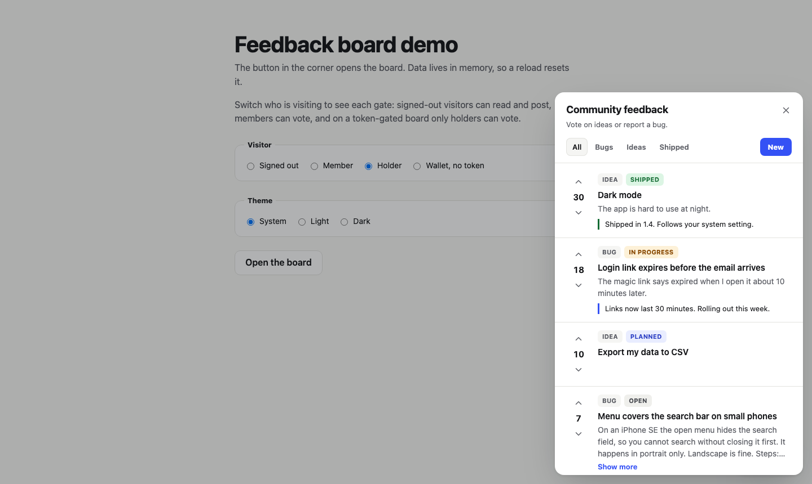
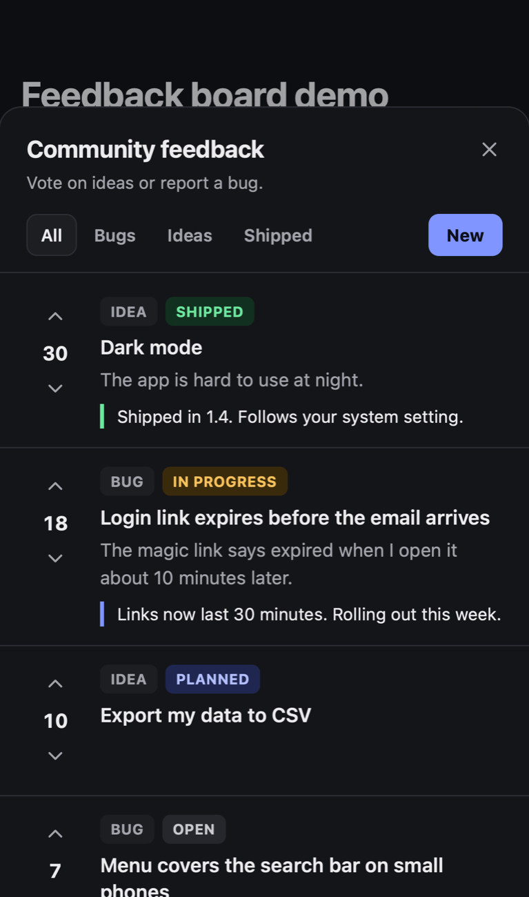

# Feedback Board

A small community feedback board for any website or app. A floating button opens a panel where people see everyone's feedback, vote it up or down, post a bug or an idea, and see its status change to **Shipped**. It can be token gated for NFT communities, so only holders vote.

This repo is written to be handed to a coding agent. The spec says what to build and which rules to keep. Your agent builds it on whatever stack you already use.

<p>
  
  
</p>

## Give it to your agent

Paste this into Claude Code, Cursor, Codex, or any coding agent working in your project:

> Read FEEDBACK-BOARD.md from https://github.com/staybased/feedback-board and build a community feedback board into this project. Follow its section 0.

For an NFT community, add:

> Gate voting to holders of `<contract address>` on `<chain>`. Follow section 10.

## Why a board instead of a feedback form

- **Everyone sees everything.** Votes show what matters to many people, so you don't chase one person's confusion.
- **People see their post land and can follow it.** Seeing *Shipped* on something they asked for keeps early users engaged.
- **Downvoted and stale items sink on their own.** Nobody has to triage them.

## What's in here

| File | What it is |
|---|---|
| [`FEEDBACK-BOARD.md`](FEEDBACK-BOARD.md) | **The spec.** Concept, rules, data model, API, widget, platform recipes, token gating, acceptance checks. Self-contained. |
| [`reference/schema.sql`](reference/schema.sql) | Postgres tables and functions: ranked list, validated and rate-limited posting, one-tap vote toggle, token ballots, owner-only status. |
| [`reference/supabase.sql`](reference/supabase.sql) | Browser-callable wrappers for Supabase, so a static site needs no server of its own. |
| [`reference/feedback-board.js`](reference/feedback-board.js) | The widget as a framework-free custom element, `<feedback-board>`, with an adapter for any backend. |
| [`reference/token-gate.mjs`](reference/token-gate.mjs) | Wallet sign-in (EIP-4361) and holder checks for ERC-721, ERC-1155, and ERC-20, using viem. |
| [`reference/demo.html`](reference/demo.html) | The widget running on in-memory data, with switches for signed-out, member, holder, and non-holder visitors. |

The reference files are tested examples, not a package to install. Your agent should adapt them to your project.

## Try the demo

```sh
node tests/serve.mjs
```

Then open http://localhost:4173. No install needed.

## Run the tests

You need Node 20+, Docker (for the SQL tests), and [Foundry](https://getfoundry.sh) (for the token-gate tests).

```sh
npm install
npx playwright install chromium firefox webkit
npm test
```

- **SQL:** the schema runs on stock Postgres and on the Supabase Postgres image. The tests cover validation, rate limits, the vote toggle, token ballots, and what each role can and can't do.
- **Token gate:** runs against a local anvil chain. It covers sign-in replay, wrong domain, wrong chain, expiry, wrong signer, holder checks for each token standard, ballots after transfers, and RPC outages.
- **Widget:** Playwright in Chromium, Firefox, WebKit, and an iPhone viewport. It covers voting, gating, posting, HTML injection, keyboard use, axe accessibility scans in light and dark themes, and layout from 320px to 1920px.

## License

[MIT](LICENSE)
